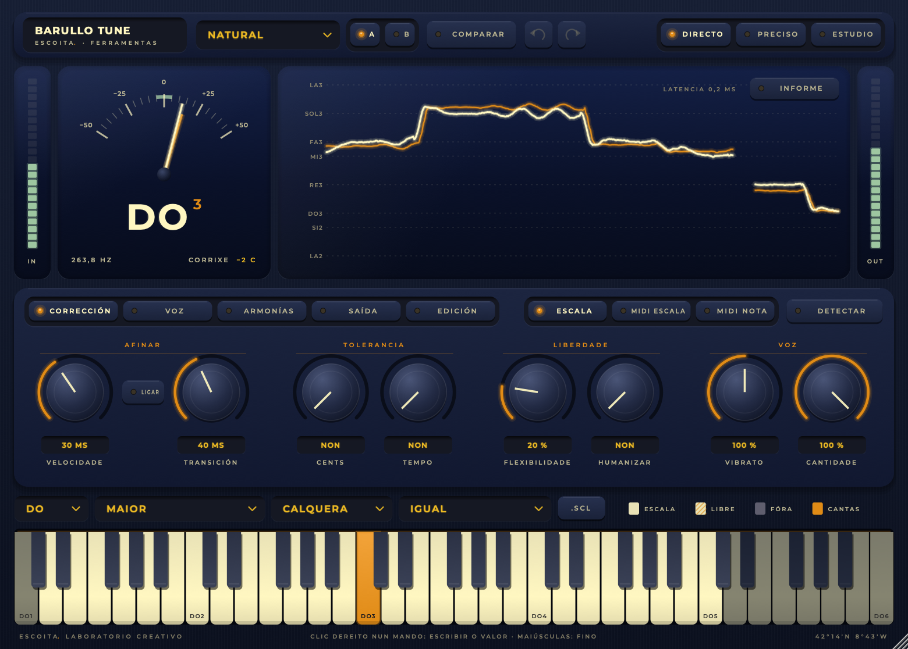
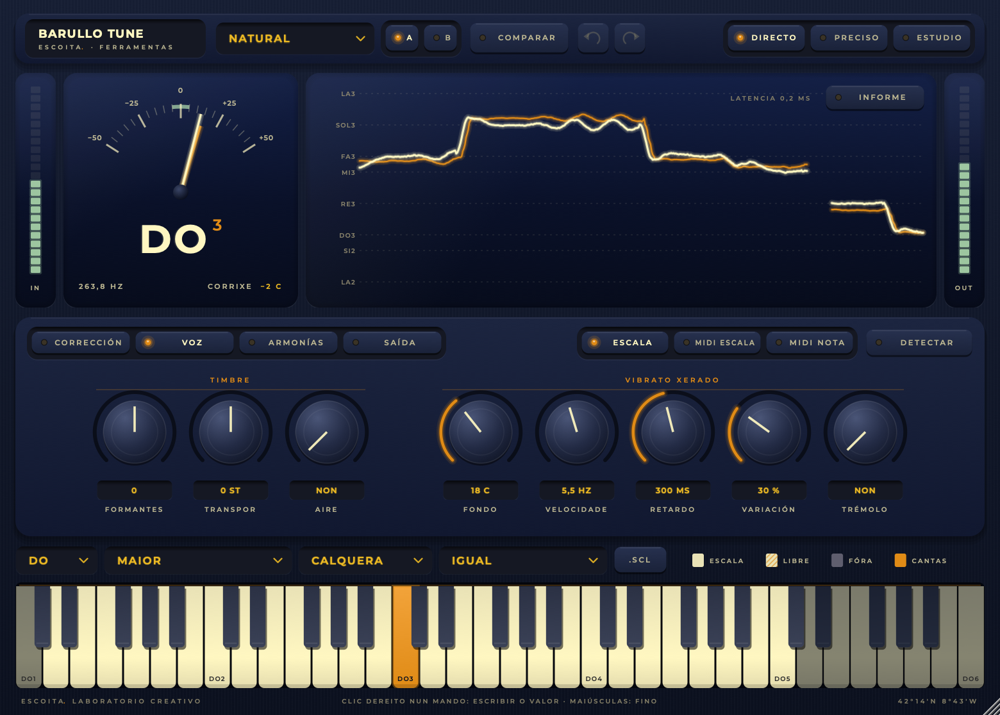
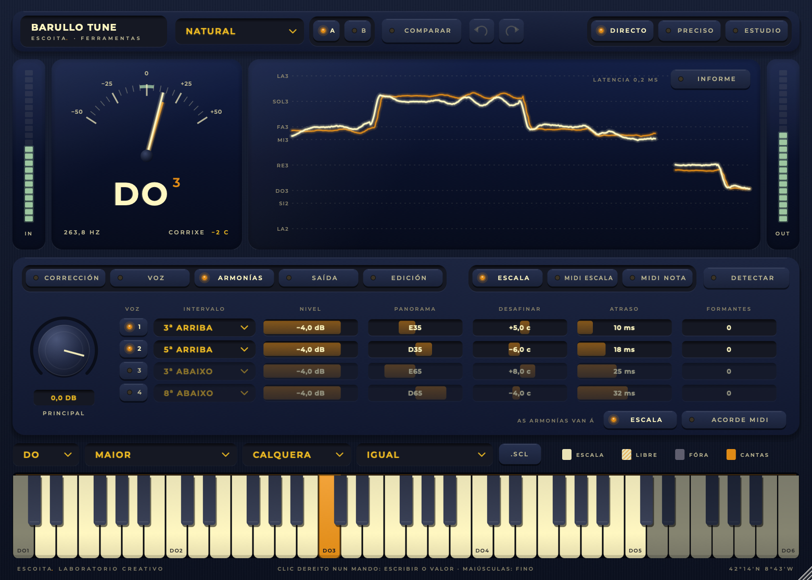
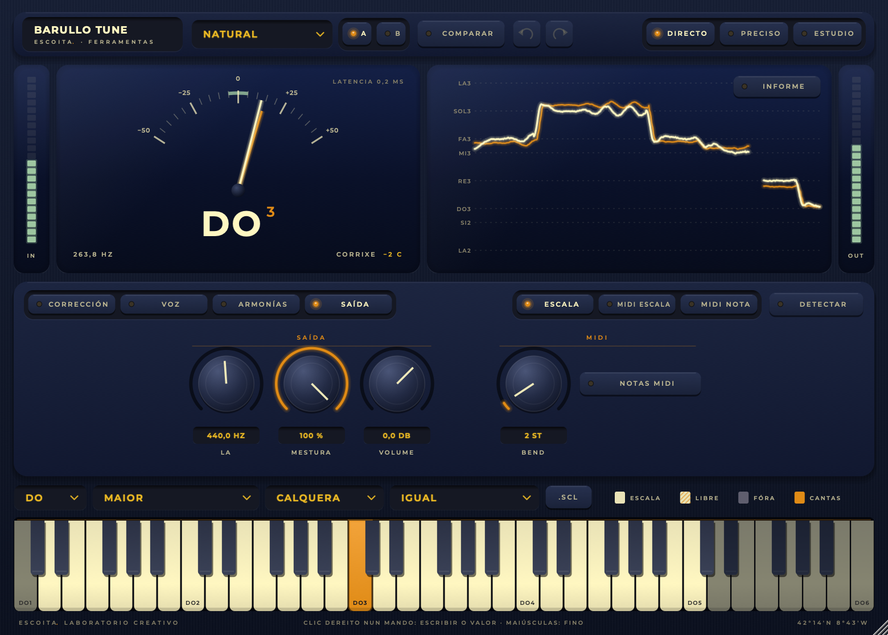
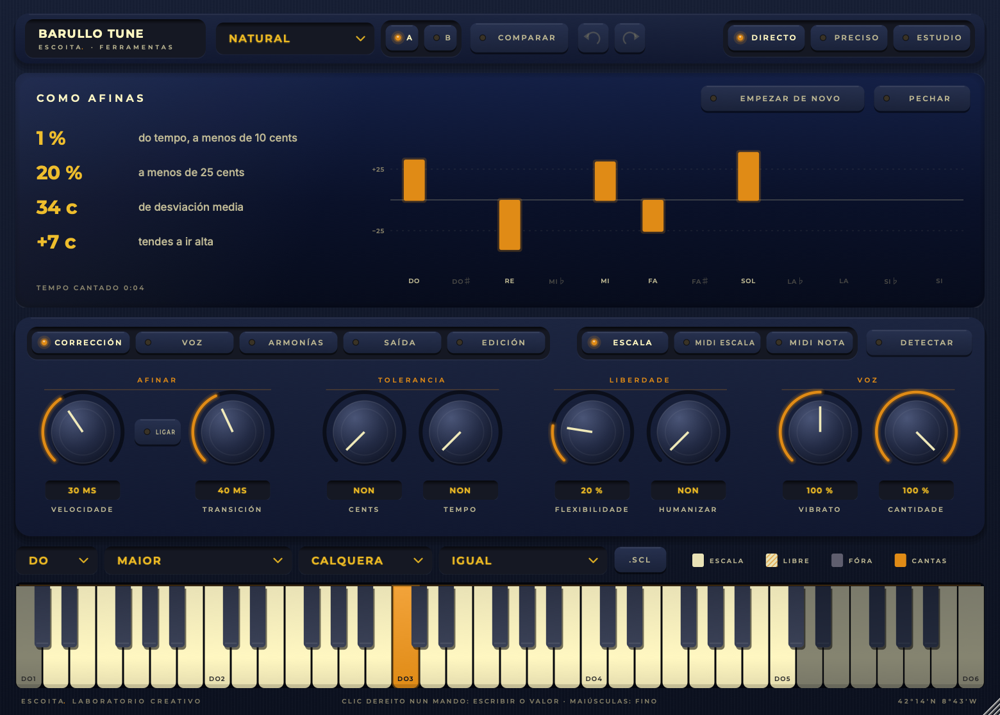

# Barullo Tune — manual

Barullo Tune afina a voz mentres cantas: dende unha corrección que case non se nota, que respecta o vibrato e as notas que buscas a propósito, ata o efecto robot. Tamén transpón sen voz de esquío, fai ata catro armonías, xera vibrato, entende MIDI e di como afinas ti.

Unha ferramenta de [Escoita](https://www.escoita.link).

## Para empezar, en tres pasos

1. **Pon Barullo Tune na pista da voz** (VST3, AU, CLAP ou LV2), ou abre a aplicación.
2. **Escolle a tonalidade**: tónica e escala na fila de baixo. Se non a sabes, pulsa **Detectar** e canta uns segundos; se mandas a base á entrada lateral «Acompañamento», abonda con que soe a base.
3. **Escolle un preset**: «Natural» para unha corrección que non se nota, «Robot» para o efecto.

Xa está. O resto é afinar o carácter.

## Os tres xeitos

Arriba á dereita:

| Xeito | Latencia | Para que |
|---|---|---|
| **Directo** | 0 para o DAW (0,25 ms de verdade) | cantar en directo escoitándote |
| **Preciso** | 12 ms | gravar, ou directo se non che molesta un pouco de atraso; afina o dobre de exacto ca Directo |
| **Estudio** | 15–42 ms (segundo o tipo de voz) | mesturar: o máis exacto e o mellor son ao transpor moito |

O DAW compensa a latencia ao reproducir. Directo declara 0, así que non atrasa as outras pistas. Cambiar de xeito en marcha non fai estalo.

## A pantalla

- **Á esquerda**, a nota á que vai a voz. A agulla laranxa é a túa voz e a branca a afinada, en cents (−50 a +50).
- **Á dereita**, o ton nos últimos segundos: laranxa a túa voz, branco a afinada.
- **Informe**: como afinas ti. Mira «Practicar», máis abaixo.

## Corrección

| Mando | Que fai |
|---|---|
| **Velocidade** | Canto tarda en levar a voz á nota dentro de cada nota. 0 ms: ao momento (robot). |
| **Transición** | Canto tarda en pasar dunha nota á seguinte. Baixo, saltos secos; alto, portamentos suaves. Co botón **ligar**, velocidade e transición móvense xuntas. |
| **Tolerancia: cents** | As desafinacións máis pequenas ca isto non se tocan. |
| **Tolerancia: tempo** | As máis curtas ca isto tampouco (adornos, ataques). |
| **Flexibilidade** | O contrario da tolerancia: canto máis lonxe da nota vai a voz, menos se corrixe. As blue notes e os arrastres quedan; o que está preto, afínase. |
| **Humanizar** | As notas curtas corríxense en seco; nas longas a corrección vaise relaxando e a nota respira. |
| **Vibrato** | Canto do teu vibrato pasa: 0 % apláñao, 100 % déixao igual, 200 % dóbrao. Só se respecta un vibrato regular: a oscilación irregular dunha voz insegura corríxese. |
| **Cantidade** | 100 % leva a voz á nota; 50 % deixa a metade da desafinación. |

## Voz

- **Formantes**: move o timbre sen cambiar a nota (para arriba, voz máis pequena; para abaixo, máis grande). É o que noutros afinadores se chama «lonxitude da garganta».
- **Transpor**: ±12 semitonos mantendo o timbre, en calquera xeito.
- **Aire**: alento enriba da voz afinada.
- **Vibrato xerado**: un vibrato novo, enriba do da voz. Tes **fondo** en cents, **velocidade** en Hz e **retardo** desde o comezo de cada nota, onde entra amodo. A **variación** fai que a velocidade e o fondo cambien amodo, coma nunha voz. O **trémolo** fai que o nivel oscile ao mesmo compás.

## Armonías

Ata catro voces novas a partir da túa. Cada fila é unha armonía:

- **o número** acéndea ou apágaa;
- **intervalo**: de oitava abaixo a oitava arriba, en graos da escala (a terceira dunha nota é a nota da escala dous pasos arriba: maior ou menor segundo caia);
- **nivel**, **panorama**, **desafinar** (uns cents, para que non soe pegada á principal), **atraso** (uns ms, coma alguén que canta contigo) e **formantes** (outra persoa).

Arriba á dereita, o modo: **Escala** (cada armonía no seu intervalo) ou **Acorde MIDI** (cada armonía vai a unha das teclas que toques, de grave a aguda). **Principal** é o nivel da túa voz: á esquerda do todo, quedas só coas armonías (para gravalas nunha pista aparte).

As armonías levan a mesma corrección e a mesma expresión ca a túa voz (vibrato, arrastres). Sen ton (consoantes) cállanse.

## Saída

- **La**: a afinación de referencia (415–466 Hz).
- **Mestura**: canto de voz afinada; por baixo de 100 % mestúrase coa orixinal, aliñada.
- **Volume**.
- **Bend**: canto dobra a roda de pitch bend en MIDI nota (1–24 semitonos).
- **Notas MIDI**: as notas que cantas saen como notas MIDI, para tocar un sintetizador coa voz.

## Escala, notas e afinación

A fila de baixo:

- **Escala / MIDI escala / MIDI nota**. Con **Escala**, a voz vai á nota máis próxima da escala. Con **MIDI escala**, as teclas que toques fan de escala. Con **MIDI nota**, a voz vai á tecla exacta e a roda de pitch bend dóbraa. Compatible con **MPE**: cada nota co bend da súa canle.
- **Tónica e escala**: hai vinte escalas, da cromática á frixia dominante do flamenco, máis a personalizada.
- **Voz**: o tipo de voz. O afinador só busca no seu rango, así non salta de oitava; en Estudio, unha voz aguda ten menos latencia.
- **Afinación**:
  - **Igual**: os doce semitonos iguais.
  - **Xusta**: terceiras e quintas puras respecto da tónica.
  - **Personalizada**: os cents de cada nota.
  - **MTS-ESP**: a que diga o mestre de MTS-ESP, ou as mensaxes MIDI de afinación.
- **.scl**: importa unha escala de Scala, coas súas notas e os seus cents desde a tónica.

**O teclado**: a tira de enriba de cada tecla di se a nota está na escala (branca), fóra (escura) ou libre (laranxa: cantando nela non se corrixe).

- Clic: pon ou quita a nota da escala, en todas as oitavas.
- Clic dereito: déixaa libre.
- Coa afinación Personalizada, **maiúsculas + arrastrar** arriba ou abaixo cambia os cents da nota.

## Presets, A/B e desfacer

- **Presets**: os de fábrica só cambian o carácter da corrección, non a tonalidade nin a voz. Hai Natural, Suave, Pop, Balada, Robot, Trap, Directo seguro, Xigante e Trasno. No mesmo menú podes **gardar como preset**: os teus gardan todo, en Documentos/Barullo Tune/Presets.
- **A/B**: dous xogos de axustes para comparar. Cambiar de lado garda o actual; no menú dos presets podes copiar un lado no outro.
- **Desfacer e refacer**: as frechas da cabeceira.
- **Comparar**: escoitas a voz sen afinar, aliñada e sen armonías.

## Practicar

Pulsa **Informe** na pantalla e canta: verás como afinas ti, coa voz que entra antes de corrixila. Tes:

- o tempo cantado;
- canto del estás a menos de 10 e de 25 cents;
- a desviación media e se tendes a ir alta ou baixa;
- unha barra por nota: as laranxas son as que se desvían máis de 10 cents.

**Empezar de novo** ponse a cero. Na aplicación independente, é unha boa maneira de practicar escalas e cancións.

Na aplicación independente tes tamén, na cabeceira, **gravar** (o círculo) e **escoitar** (o triángulo). Gravar garda a saída nun WAV, en Música/Barullo Tune. Escoitar fai soar a última toma en bucle, para cantar enriba ou escoitarte.

## Receitas

- **Voz pop limpa, sen que se note**: preset Natural ou Pop, en Preciso ou Estudio. Sobe a **tolerancia** uns 5–10 cents se queres deixar a voz máis viva.
- **Balada con notas longas que respiran**: preset Balada; **humanizar** ao 50 % e vibrato ao 100–120 %.
- **Blues ou flamenco**: escala blues ou frixia dominante, **flexibilidade** ao 40–60 %. As notas que buscas a propósito quedan.
- **Efecto robot**: preset Robot (velocidade e transición a 0, vibrato a 0 %).
- **Directo**: xeito Directo e preset «Directo seguro».
- **Coros**: Armonías con dúas voces, por exemplo 3ª arriba e 5ª arriba. Pon o panorama aberto e uns cents e ms distintos en cada unha.
- **Voz a outra voz**: transpor −12 e formantes −4 (preset Xigante), ou +12 e +4 (Trasno), en Estudio.
- **Tocar un sintetizador coa voz**: acende **Notas MIDI** e manda a saída MIDI da pista a un instrumento.

## Teclado e accesibilidade

- **O tabulador** percorre os controis; o que ten o foco vese en laranxa e as frechas móveno.
- **Clic dereito** (ou Cmd/Ctrl-clic, ou intro) nun mando: escribe o valor, por exemplo «35 ms», «−3,5 dB» ou «E40» (panorama 40 á esquerda).
- **Maiúsculas ao arrastrar**: axuste fino.
- **O teclado da escala** vai sen rato. As frechas móvense pola nota (arriba e abaixo, oitavas), o espazo pona ou quítaa da escala e F déixaa libre. Coa afinación Personalizada, maiúsculas + arriba/abaixo cambia os cents.
- **Lectores de pantalla**: todos os controis teñen nome e a pantalla anuncia a nota e canto corrixe.

## Problemas frecuentes

- **Salta de oitava ou colle mal a nota**: escolle o **tipo de voz** (baixo, tenor, soprano…) en vez de «Calquera».
- **Non afina nada**: mira que a voz entre (o medidor de entrada) e que a escala teña notas. Mira tamén que a cantidade non estea a 0 % e que a tolerancia non estea moi alta.
- **Soa robótico sen querer**: sobe a **velocidade** (20–60 ms), a **transición** (40–120 ms) e o **vibrato** ao 100 %.
- **Atraso no directo**: usa o xeito **Directo**.
- **O DAW non ve o plugin**: no Mac, abre o instalador co clic dereito → Abrir. En Windows, «Máis información» → «Executar de todos os xeitos». Volve buscar plugins no DAW.
- **Ruído ou reverberación na voz**: o detector aguanta ruído ata uns 5 dB de relación sinal/ruído, pero unha voz seca e próxima sempre afina mellor.

---

As capturas fanse soas con `tools/capturas.sh` (a partir da proba sen interface), así o manual vai sempre coa versión.
